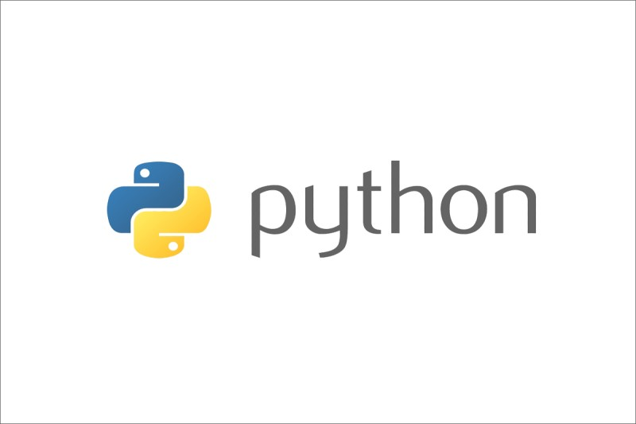

# 개요  

{: width="80%" height="80%"} 

<br/>
이번 포스팅에서는 `tqdm`라는 파이썬 라이브러리를 활용해서, for문이나 apply등 긴 시간이 소요될 수 있는 반복문에서 현재 진행상황을 모니터링 할 수 있는 방법에 대해 알아보자.  

```python
from tqdm import tqdm
```

전에는 단순히 `print`로 로그를 출력하거나 했지만, 이 라이브러리를 사용하면 bar 형태로 진행상황을 간편하고 친절하게 알려준다.  


<br/>
# for문에 적용  

`for`문에 활용하기 위해서는 총량을 의미하는 `in`인자 우측의 변수에 `tqdm`을 씌워주기만 하면 된다.  

```python
import numpy as np
i=0
for i in tqdm(np.random.rand(10000000)):
    i = i**2
```

```
36%|██████████▋                      | 3598074/10000000 [00:02<00:03, 1797859.85it/s]

```


<br/>
# apply문에 적용  

`apply`문에 적용하기 위해서는 pandas 전용 `tqdm.pandas()`를 선언해준 후에, `progress_apply`함수를 이용해서 동일한 방식으로 사용해주기만 하면 된다.  

```python
import pandas as pd
test = pd.DataFrame({"col1":np.random.rand(1000000)})
```


```python
tqdm.pandas()
test["col1"].progress_apply(lambda x : x*2)
```

```
66%|████████████████████▉            | 660627/1000000 [00:00<00:00, 1251488.30it/s]
```


    0         0.249799
    1         1.307598
    2         0.779009
    3         1.698456
    4         0.365209
                ...   
    999995    0.873436
    999996    0.545571
    999997    0.911607
    999998    0.648300
    999999    0.479302
    Name: col1, Length: 1000000, dtype: float64


## 버전관리  

**tqdm <= 4.8** 이하의 버전에서는 아래와 같은 방식을 권고하고 있다([참고](https://stackoverflow.com/questions/18603270/progress-indicator-during-pandas-operations)).  

```python
tqdm_pandas(tqdm())
```

