# 개요

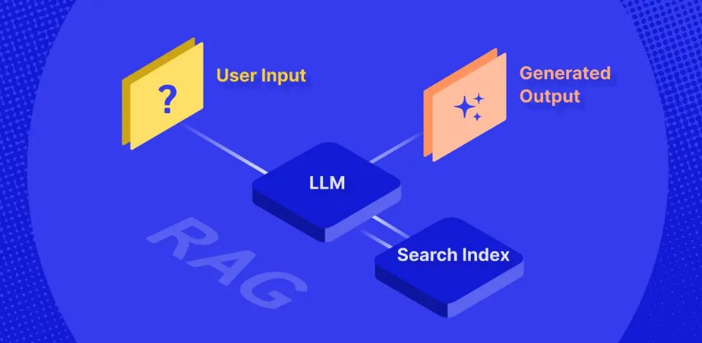{: width="100%" height="100%"}  
출처: https://www.glean.com/  

이번 포스팅은 AI application 기술로 급격히 발전하고 있는 **RAG(Retrieval-Augmented Generation)** 기술의 최신 논문([Wang et al.](https://arxiv.org/pdf/2407.01219))에 대한 리뷰이다. 연구에서는 RAG Workflow의 모듈별 상세한 정리와 각 모듈에 대한 다양한 실험을 통해 성능 비교가 수행된다.  
Data Science 분야에서는 초기에 여러 연구자들에 의해 산발적으로 인사이트들이 누적된 이후, **그래서 뭘 써야하는데?** 라는 물음에 대한 답을 정리해주는 논문이 나오기 마련이다. 이 논문이 바로 그런 역할을 해줄 것으로 기대한다.  

RAG 기술은 기존 LLM 활용한 AI Application을 만드려고 할때 생기는 한계들로부터 파생된다.  

1. **Hallucination 문제**  
    - 정확한 정보를 제공하기 보다는 자연스러운 문장 생성에 초점이 맞춰져있다.
    - 부정확한 정보는 기업 도입에 리스크가 크다.  
2. **지식의 편향 문제**  
    - LLM이 학습된 데이터는 최신 정보나 특정 도메인의 정보를 제공하기 어렵다.
    - 기업 도입 측면에서는 신규 데이터에 대한 지속 투입이 필요하다.  
3. **비용 문제**  
    - LLM의 Fine-tuning이 가능한 기업이 얼마나 있을까

따라서 LLM이라는 거대한 가중치를 건드리지 않고도 효율적이고 정확한 정보를 제공하는 AI application을 기업 내부에 도입하기 위한 고민이 필요해진다. 이러한 Background를 인지한 상태에서 논문을 리뷰해보기로 하자.  

 

# 1. Introduction

> 💡 **Key point**  
> 1. RAG Proecss를 상세하게 정리하고 기존 접근방법들을 정리
> 2. 다양한 실험 환경에서 performance와 efficiency 비교
> 3. Multimodal retrieval 전략에 대한 잠재력 논의

## RAG workflow

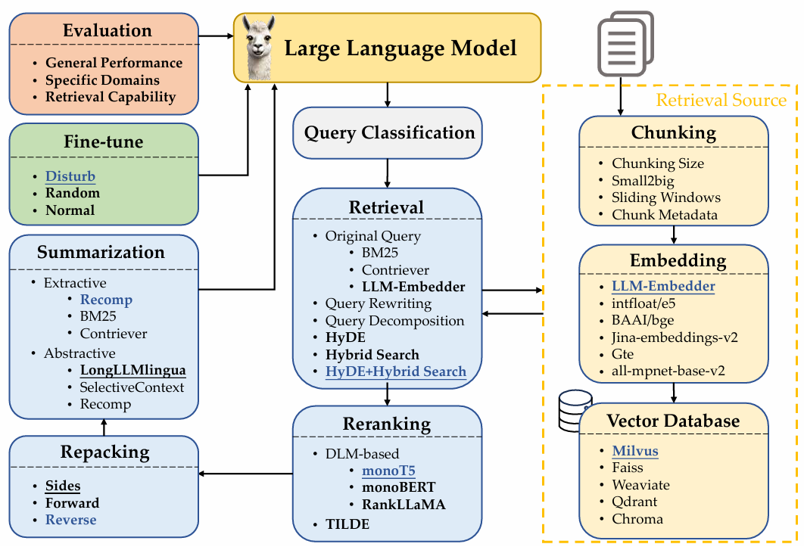{: width="90%" height="90%"}

1. **query classification**
   - Retrieval이 필요한 질문인지 여부를 분류
2. **retrieval**
   - 질문과 유사한 정보를 DB에서 가져오기
   - DB는 어떻게 구성해야 되는데?
     - (2-1) **Chunking -** 잘 분할하기 위한 방법을 결정하고
     - (2-2) **Embedding -** 의미를 잘 반영된 vector 생성을 위한 model을 고르고 \*\*\*\*
     - (2-3) **Vector Database** - 효율적으로 적재할 DB를 선택해야된다.
3. **reranking**
   - DB에서 가져온 정보들을 질문과 관련도가 높은 순으로 정렬
4. **repacking**
   - 가져온 정보들을 구조화된 정보로 재구성(더 나은 생성을 위해)
5. **summarization**
   - repacking된 정보에서 Response 생성을 위해 핵심 정보만 요약(중복제거 등)
6. **Fine-tune**
   - Response를 생성할 LLM의 효율적인 튜닝
7. **Evaluation**
   - Response에 대한 성능 평가

위 workflow에서 각 단계 별로 세부적인 technique들을 추가해서 여러가지 방법들이 제안되고 있다.  
그러나 여러 방법에 대한 성능 비교 및 optimal에 대한 평가를 진행한 논문은 현재까지 없었다.

> 💡 **Contribution**  
> 다양하게 개발되고 있는 **RAG 테크닉들을 체계적으로 성능 비교**를 해보겠다.  
> 이를 위해 각 모듈별로 다양한 **Baseline**,**성능 지표**, **데이터셋**들이 필요할 거고  
> 결과를 기반으로 **최적의 조합**을 찾고 **다른 방법도 제안**해볼 수 있을 것임

 

# 2. Related Work

## 2.1. Query and Retrieval Transformation

- 질문을 변형시켜 검색 성능을 향상시키기 위한 노력들

  - Query2Doc, HyDE: 질문으로 pseudo-documents를 생성해서 이걸로 검색하도록 함
  - TOC: 질문을 하위 질문들로 분리시켜서 검색하고 최종 집계

- 검색 source를 변형시켜 성능 향상시키기 위한 노력들
  - LlamaIndex: 반대로 documents에서 pseudo-query를 생성하는 UI를 제공하고 있음

## 2.2. Retriever Enhancement Strategy

- Chunking, Embedding, Reranking에 대한 성능 고도화를 위한 노력들

## 2.3. Retriever and Generator Fine-tuning

- Retriever (Embedding Model + Reranking Model)의 최적화 → **검색 성능의 향상**
- Generator (LLM)의 최적화 → **답변 생성 성능의 향상**

 

# 3. RAG Workflow

## 3.1. Query Classificaion

- 항상 RAG를 쓸 필요는 없으며, 오히려 응답 생성 시간을 증가시킴
- Query가 들어왔을 때 RAG가 필요한지 여부만 판단해주면 됨
  - 분류 모델 활용
  - Query별로 RAG가 필요한 유형과 불필요한 유형을 Labelling
  - Example)
    - Translation 유형 - RAG 불필요
    - Summarztion 유형 - RAG 불필요
    - Search 유형 - **RAG 필요**
    - Suggestion 유형 - **RAG 필요**
    - 등등.

## 3.2. Chunking

- Chunking을 위한 고려사항
  - **Token-level** - 가장 간단하지만 문장 본연의 의미를 해칠 수 있음
  - **Semantic-level** - breakpoint에도 LLM을 사용, but 비용 효율성이 낮음
  - **Sentence-level** - 문장 단위로 짤라서 의미 보존과 효율성도 같이 가져감
    - 본 연구에서 사용한 방법

**결국 문장 본연의 의미 보존과 효율성과의 균형을 잡는게 필요 (모든 task가 마찬가지임)**

### 3.2.1 Chunk size

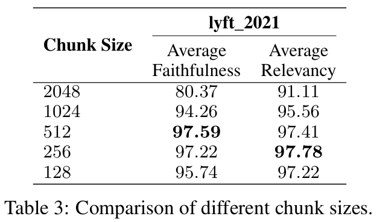{: width="45%" height="45%"}

- **Trade-off**
  - size가 클수록(크게 나눌수록) → 문맥 이해가 쉽지만 검색시간 등 증가
  - size가 작을수록(작게 나눌수록) → 그 반대
    - 지표를 통해 적절한 optimal point를 잡아야 함
  - Faithfulness - **답변이** hallucination이 발생했는지, Retrieval된 텍스트와 일치하는지
  - Relevancy - **질문이** Retrieval된 텍스트와 일치하는지
- **실험 셋팅**
  - LamaIndex(Framework)에서 제공하는 위 지표들 사용
  - Embedding Model: **text-embedding-ada-002**
  - Generation Model: **zephyr-7b-alpha**
  - Evaluation Model: **gpt-3.5-turbo**
  - Chunk Overlap: **20 tokens**
  - Datasets: **lyft_2021**

### 3.2.2~3 Chinking Techniques & Embedding Model Selection

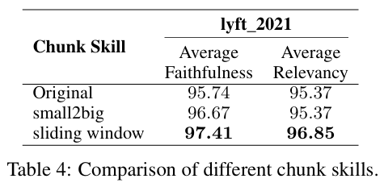{: width="45%" height="45%"}

- **small-to-big, sliding window**

  - Chunk된 블록 들 간의 관계를 담고 있도록 설계
  - Small-sized 블록은 질문(query)와 매칭되도록 하고, Larger block이 문맥 정보를 포함해서 반환하도록 구현

- 실험 셋팅

  - Embedding Model: LLM-Embedder
  - Small-sized : 175 tokens
  - Large-sized : 512 tokens
  - Chunk Overlap: 20 tokens
  - Datasets: Lyft_2021

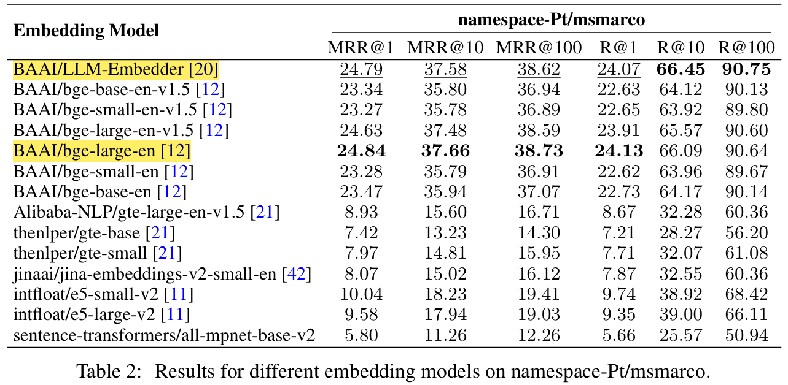{: width="85%" height="85%"}

- **Embedding Model**
  - 질문(Query)와 Chunk block들 간의 의미를 매칭(유사도, 관련성 등)하는데 중요한 역할
- 실험 셋팅

  - Embedding Model: LLM-Embedder
  - Evaluation Model: FlagEmbedding
  - Datasets  
    - Query: namespace-Pt/msmarco
    - Corpus: namespace-Pt/msmarco-corpus

**두 모델의 성능은 비슷하지만, LLM-Embedder의 size가 3배 가볍기 때문에, 이걸로 선택!**  

### 3.2.4 Metadata Addition

- Chunk 블록에 부가적인 정보(title, keywords, 가상의 질문 query 등)를 달아놓으면 검색성능을 개선시킬 수 있음

## 3.3 Vector Databases

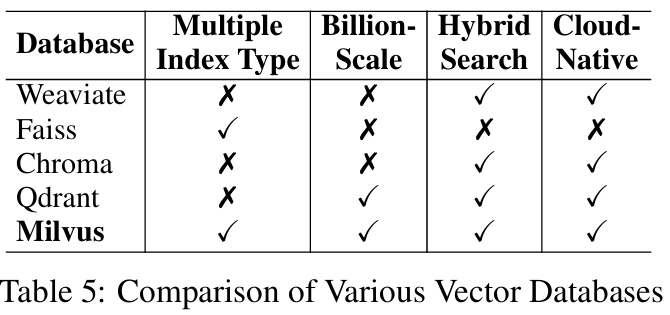{: width="45%" height="45%"}  

- 위와 같이 임베딩된 vector들을 효율적으로 저장하고 검색할 수 있도록 고완된 DB
- 4가지 Vector DB 유형
  - **Multiple Index types**: 다양한 데이터 특성에 따라 검색을 최적화할 수 있는 유연성이 존재
  - **Billion-Scale vector support**: 대용량 데이터셋 처리에 초점
  - **Hybrid search**: Vector 검색과 Keyword 검색을 결합 → 검색 정확도 향상
  - **Cloud-Native capabilities**: 클라우드 환경에서의 통합 및 확장성 보장

## 3.4 Retrieval Methods

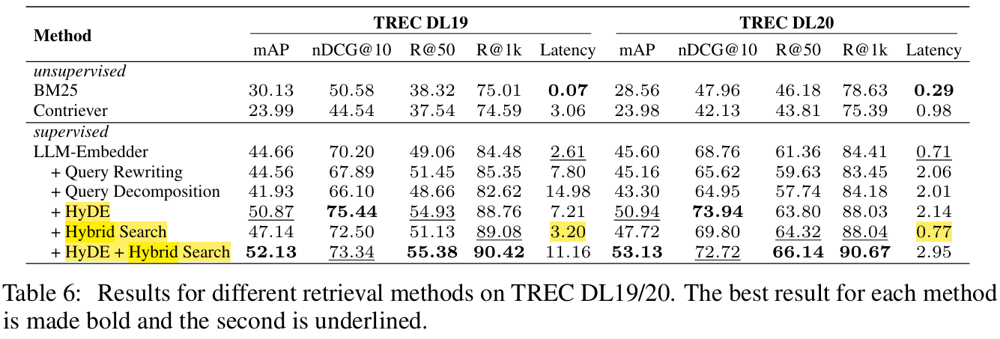{: width="100%" height="100%"}

- 검색 성능 향상을 위해 주어진 Query를 그대로 사용하지 않고 변환하는 방법
  - **Query Rewriting**: LLM에게 Query를 입력해 개선된 Query로 반환
  - **Query Decomposition**: 하위 Query로 분할시켜 검색하는 방법 → 복잡함
  - **Pseudo-documents Generation**: Query로 가상 corpus를 만들고 가상 reponse에 대한 임베딩으로 검색하는 방법. ex) HyDE
- 실험 Baseline(unsupervised contrastive encoder)
  - Sparse Retrieval - BM25
  - Dense Retrieval - Contriever

### 3.4.2 HyDE - 가상 document 별 성능비교

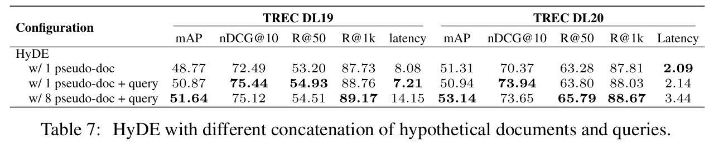{: width="90%" height="90%"}

- 가상 document를 늘리면 성능이 기본적으로 증가
- But 지연 시간(Latency)도 증가하기 때문에 효율성이 감소함
  (성능 대비 지연시간이 크게 증가)

결론: **1개의 가상 document 만으로도 충분하다!**

### 3.4.3 Hybrid Search - Sparse & Dense Retrieval 간의 가중치 비교

$$ S_{h}= \alpha \cdot S_{s} + S_{d}$$

- α값의 조정이 성능에 영향을 미치는 것을 확인 ⇒ **α = 0.3** 선택  

## 3.5 Reranking Methods

- **DLM Reranking**: Classification 활용 (**성능에 초점**)
  - Reranking에 DLM 활용
  - Query-Document 간의 관련성에 대해 True/False 값으로 분류하도록 Fine tuning 됨
  - True로 분류한 Probability에 따라 순위 조정
- **TILDE Reranking**: Query Likelihood (**효율성에 초점**)
  - Model의 vocabulary 전체에 대해 Token Probability를 계산하여 likelihood 값을 독립적으로 계산해 둠
  - Document는 이 probability 합산하여 score를 매기고, reranking을 수행함
- 실험 셋팅
  - Models
    - **monoT5 → Best Model**
    - monoBERT
    - RankLLaMA
    - TILDEv2
  - Datasets : MSMARCO

## 3.6 Document Repacking

- Forward: Reranking 단계에서 score가 높았던 순서로 document를 repacking함
- Reverse: 위와 동일하며 낮았던 순서로 repacking함
- **Sides: 위아래로 repacking → 선택**
  - Batch로 학습시킬 때, 중요한 정보가 애매하게 있는 것보다 처음 또는 마지막에 위치하는 것이 성능이 좋기 때문임 (Liu et al.)

## 3.7 Summarization

- LLM의 generation을 효율화하기 위해 Retrieval document를 요약하는 과정
  - Extractive한 방법
    - 텍스트를 문장단위로 분할 → 중요도에 따라 score를 부여
  - Abstractive한 방법
    - 여러 document에서 정보를 통합하여 재구성 → 일관성 있는 요약 생성
- 방법론들
  - Recomp - 유용한 문장 선택(extractive) or 여러 docs에서 정보 종합(asbtractive)
  - LongLLMLingua - Query와 관련된 핵심 정보에 집중
  - SelectiveContext - Input context에서 중복된 정보를 제거
    - non-query-based 방법임
- 실험 셋팅
  - Datasets: NQ, TriviaQA, HotpotQA
- Recomp (abstractive)이 가장 성능이 좋음
- LongLLMLingua는 성능은 그다지 좋진 않지만, 해당 데이터셋에서 학습되지 않았음에도 준수한 성능이 나오는 것은 주목할 만 함

## 3.8 Generator Fine-tuning

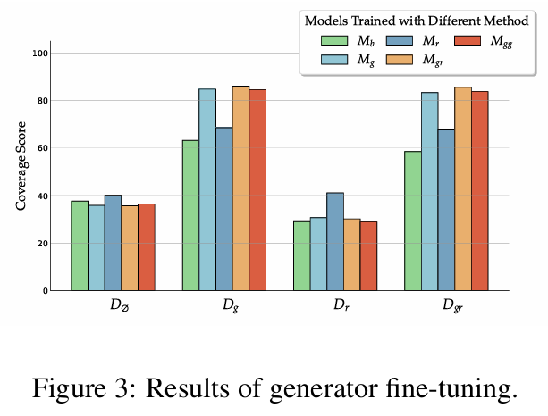{: width="50%" height="50%"}

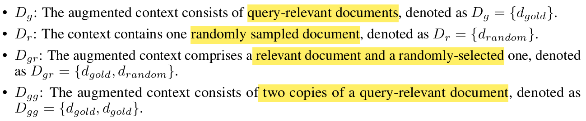{: width="90%" height="90%"}

- 각각의 data로 모델들을 각각 fine-tuning하고, Validation set도 각각을 놓고 비교함
  - 초기 모델로 Llama-2 7B 사용
- $D_{gr}$로 fine-tuning 했던 $M_{gr}$이 다른 Dataset에서도 대부분의 데이터셋에서 높은 성능을 보임
  - **Mixed 해서 학습시켰을 때 robust하면서도 relevant docs도 효과적으로 활용함**

 

# 4. Searching for Best RAG Practices

> 💡 지금까지 모듈 별로 실험한 결과에서 Best Method 후보들만 사용해서 반복 실험  
> ⇒ Best RAG Process를 결정    

- 실험 셋팅
  - 5가지 NLP 시나리오
    - (I) Commonsense Reasoning → Acc 평가
    - (II) Fact Checking → Acc 평가
    - (III) Open-Domain QA → EM(Exact Matching), F1 score 평가
    - (IV) Multi-Hop QA → EM(Exact Matching), F1 score 평가
    - (V) Medical QA. → Acc 평가
  - RAG 평가 → Average(Faithfulness, Context Relevancy, Answer Relevancy, Answer Correctness)
- 실험 결과  

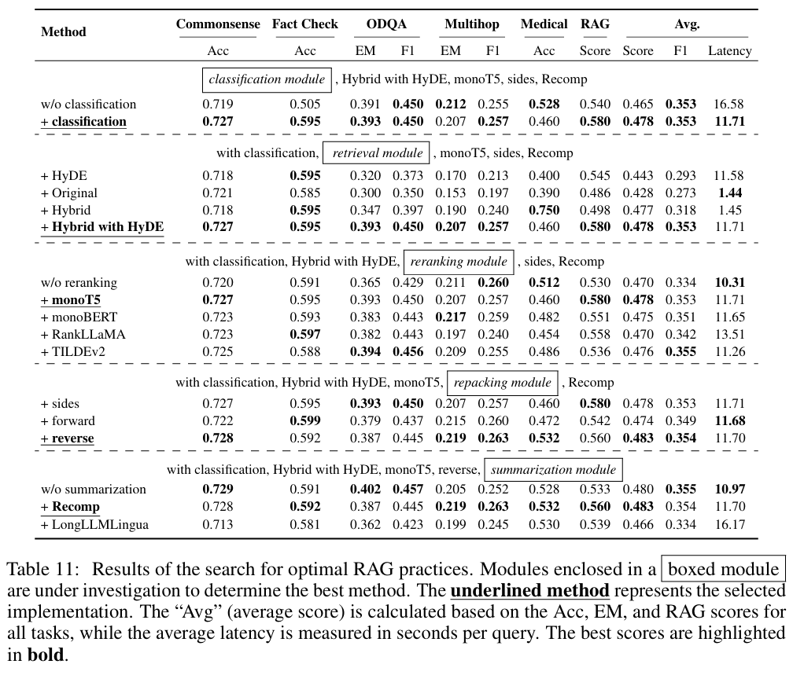{: width="90%" height="90%"}  

- Query Classification Module
    - 성능 & 효율성에 모두 기여 (0.465 → 0.478 / 16.58 → 11.71)
- Retrieval Module
    - Hybrid with HyDE가 성능은 best지만 Latency가 너무 증가함
    - Hybrid 혹은 Original을 권장
- Retrieval Module
    - w/o 의 경우 대부분의 성능이 안좋음 (reranking의 중요성을 시사함)
- Repacking Module
    - Reverse 설정이 0.560으로 우수
    - ⇒ 관련성이 높은 document를 Query에 가깝게 배치하는 것이 유리함을 보여줌 
- Summarization Module
    - Recomp가 좋지만 효율성을 우선시 한다면 제거하는 방향으로 선택

 

# 5. Discussion

## 실험 결과 정리  

- 성능 vs 효율성 간의 Trade-off를 고려하는 것이 중요  

|모듈|성능 극대화|효율성과 균형|
|:---|:---:|:---:|
| Query Classification | O | O |
| Retrieval | Hybrid with Hyde | Hybrid |
| Reranking | monoT5 | TILDEv2 |
| Repacking | Reverse | Reverse |
| Summarization | Recomp | Recomp |

## Multimodal Extension  

- Text2Image Retrieval
  - Query(텍스트)로부터 가장 유사한 이미지를 DB에서 찾음
  - 찾으면? → 반환
  - 못찾으면? → 이미지 생성 모델을 이용해서 생성 → 반환
- Image2Text Retrieval
  - Query(이미지)로부터 가장 유사한 이미지를 찾음
  - 찾으면? → 이미지 캡션 반환
  - 못찾으면? → image captioning 모델로부터 캡션 생성 → 반환
- 장점?
  - 그냥 이미지나 텍스트를 생성하기만 하면 여러 문제들이 존재함
    - 부정확함, 효율성 문제, 유지 관리 문제
  - 결국 RAG를 쓰는 이유가 Multimodal한 경우에도 이점이 된다는 얘기

## Limitation

- Retriever와 generator를 동시에 학습시키는 것을 보여준 연구들이 있으나, 본 연구에서의 Fine-tuning은 Generator인 LLM에만 집중되었음
- 각 모듈별로 대표적인 Method들을 비교하는 것이 초점을 맞추었으나, 더 다양한 chunking 기술도 있고 고려할 것은 더 많음
