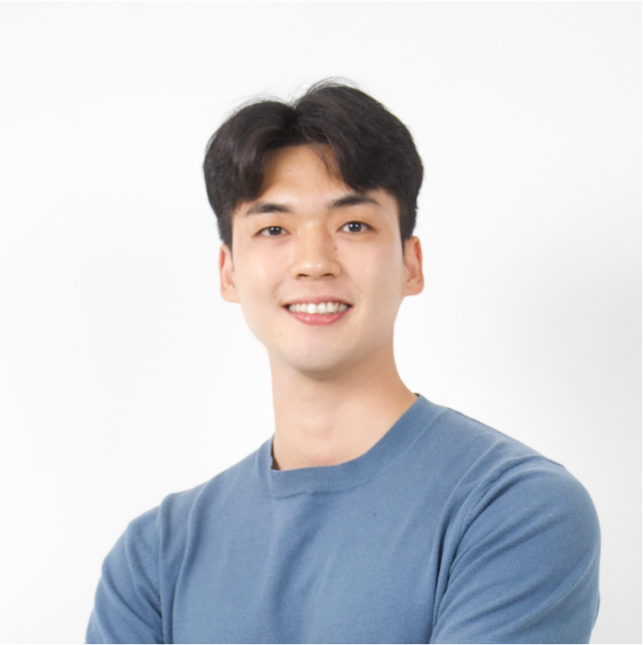

{: width="240" .rounded-10 }

데이터와 AI를 다루는 엔지니어입니다.
여기는 사이드 프로젝트와 사업 아이템을 직접 만들어 보면서 겪은 **시행착오를 그대로 기록하는 실험실**입니다.
결과가 좋든 나쁘든 숫자와 과정을 남깁니다.

## 내가 되고 싶은 사람

1. 하고자 하는 일에 진심을 다해 집중하고, 그 순간에 온전히 머무를 수 있는 사람.
2. 혼자가 주는 고요함을 즐기며, 결핍마저 따뜻하게 받아들일 줄 아는 사람.
3. 상대의 마음을 확인하려 들지 않고, 그냥 그 사람에게 묵묵히 사랑을 줄 줄 아는 사람.
4. 마음의 여유가 있는 사람. 스스로를 자책하지 않는 사람. 그러므로 남에게 관대한 사람.
5. 언제나 좋은 사람이어야 한다는 틀에 얽매이지 않는 사람. '좋은 사람' 공식의 도움 없이도 있는 그대로 좋은 사람.
6. 원칙을 세우되 수정할 줄 알고, 나의 기준을 타인에게 강요하지 않는 사람. 언제나 다양한 가능성과 선택지를 존중하는 사람.
7. 할 수 있는 것과 할 수 없는 것을 구별할 줄 아는 사람. 현실적이면서도 실행 가능한 목표를 세울 줄 아는 사람.
8. 잘 용서할 줄 아는 사람.
9. 회복탄력성이 좋은 사람.
10. 내가 되고 싶은 사람의 모습을 잊지 않고, 될 수 있다고 믿으며 살아가는 사람.
